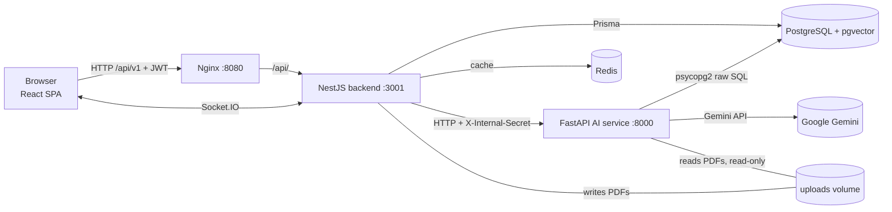

# DocLens AI

**Citation-first research assistant for academic papers.** Upload PDFs, organise them into collections, ask questions across them, compare papers, and generate literature reviews. Every answer is tied to page-level source passages, and claims without evidence are flagged.

> **No evidence = no claim.**


---

## Highlights

- **Hybrid retrieval pipeline:** BGE-M3 dense embeddings + PostgreSQL full-text keyword search, fused with Reciprocal Rank Fusion (k = 60), then re-ranked by a BGE cross-encoder (`bge-reranker-v2-m3`).
- **Grounded generation:** Gemini returns typed Pydantic answers. Citations are resolved server-side from numbered `[Evidence N]` blocks, so the model cannot invent chunk IDs.
- **Claim verification:** each claim is checked against its cited passage (number presence and token containment). Unsupported claims are disclosed in the answer and lower the confidence score.
- **Multi-paper synthesis:** structured comparison matrices, seven-section literature reviews, and research-gap analysis, each with a per-sentence verifier for citation support and paper misattribution.
- **Layout-aware ingestion:** PyMuPDF extraction with typography-based heading detection, running header/footer removal, section-bounded chunking, native table extraction, and figure/table caption chunks.
- **Real-time UX:** Socket.IO status updates during ingestion, streamed (SSE) query progress with cancel, and Markdown answers with clickable `[n]` citations.
- **Measured, not guessed:** offline evaluation harnesses for retrieval (Recall@K, MRR), grounding, abstention calibration, and latency. Results are documented with the tuning decisions behind them.

---

## Architecture



**Division of responsibilities**

| Service | Owns |
| --- | --- |
| **NestJS backend** | JWT auth, Google sign-in, ownership checks on every resource, uploads, processing orchestration, chat history, comparisons, literature reviews, notes, reading progress, public `/api/v1` API |
| **FastAPI AI service** | PDF parsing, chunking, embeddings, hybrid retrieval, re-ranking, LLM calls, claim verification, cross-paper synthesis |
| **PostgreSQL + pgvector** | Application records (via Prisma) and 1024-dimensional chunk vectors (via raw SQL from the AI service) |
| **Redis** | Cache for the backend only; not a job queue |
| **React SPA** | Hash-routed research workspace: library, collections, cited chat, report reader, comparisons, themes |

The browser never talks to the AI service or the database directly. The backend authorises each request and passes only scoped IDs to the AI service.

### Document ingestion

```text
PDF upload ─► NestJS (validate, store, ProcessingJob)
          ─► POST /ingest : PyMuPDF layout parse → section-aware chunks → paper profile
          ─► DocumentChunk rows (text, tables, captions, references, profile card)
          ─► POST /embed  : BAAI/bge-m3 (1024-d, normalised) → pgvector
          ─► Document = READY        (progress pushed over WebSocket)
```

### Question answering

```text
Question + last 20 turns
  ─► standalone rewrite (follow-ups only)
  ─► route intent (rule-based section weighting, reference exclusion)
  ─► facet split (≤ 3 sub-questions) + full question
  ─► semantic (pgvector cosine) ∥ keyword (ts_rank_cd) per facet
  ─► Reciprocal Rank Fusion (k = 60)
  ─► cross-encoder re-rank (one pass, ≤ 20 pairs)
  ─► evidence pack [Evidence N] ─► Gemini structured output (Pydantic)
  ─► resolve evidence numbers to stored chunks ─► claim + citation verification
  ─► backend re-checks scope, renumbers [n], persists Query + Citation rows
```

If the AI path fails (timeout, quota, missing key), the backend returns a clearly labelled extractive answer built from the retrieved passages. Each line cites the passage it quotes.

---

## Engineering decisions

Each decision below was made against a measured trade-off. Numbers come from the offline harnesses in `ai-service/eval/`.

| Problem | Decision | Result |
| --- | --- | --- |
| Per-facet re-ranking made answers take minutes on CPU | Gather candidates for every facet, fuse with RRF, re-rank once against the full question | Retrieval latency **148.6 s → 22.1 s** (mean, 6 questions, CPU) |
| Section-level chunks vs. fixed windows | Section-bounded chunks with a `Paper:`/`Section:` contextual header embedded with the text | Held-out Recall@5 **0.688 → 0.875** (16 questions, same retrieval stack) |
| A rule-based section boost looked helpful with a proxy model | Tuned on a validation set; the boost **reduced** recall with the real cross-encoder, so it defaults to off | Avoided a regression shipped on a weak proxy result |
| LLM answers can cite passages that were never shown | Model cites `[Evidence N]` only; backend resolves numbers to stored chunks and drops out-of-scope ones | Citations cannot point outside the retrieved set |
| Off-topic questions still produced answers | BGE-M3 relevance floor (`RETRIEVAL_MIN_SIMILARITY = 0.48`) abstains before the answer prompt | Catches all 6 off-topic test questions with no answerable question lost |
| Gemini hangs or retries for minutes | Explicit client timeout (60 s), one retry, no retry on quota or timeout errors | Bounded per-call latency; failures surface as a labelled fallback |
| Re-ingesting a paper invalidated saved citations | Chunk identity by content hash; unchanged chunks keep their ID and vector | Citations survive `reindex.py` |
| Node `fetch` cut off ingestion at 300 s | Long-running AI calls use `node:http` with a 900 s budget | Large papers no longer marked FAILED mid-embedding |
| Cross-paper search mixed vectors from different models | Semantic search only compares vectors from the active `EMBEDDING_MODEL` | Model changes can't corrupt similarity scores |
| Unauthenticated internal service | `X-Internal-Secret` on every AI route; ingest paths restricted to the upload directory | Fixes an exposed-service finding from the security review |

---

## Tech stack

**Frontend:** React 19, Vite 8, Tailwind CSS 4, hand-written hash router and context state, Socket.IO client, Markdown renderer (no raw HTML injection), light/dark/system themes. Served by Nginx.

**Backend:** NestJS 11, Prisma 7 with `@prisma/adapter-pg`, Passport JWT, Google Identity Services ID-token verification, class-validator DTOs with a global `ValidationPipe`, Socket.IO gateway, `cache-manager` (Redis), Helmet, Swagger (non-production).

**AI service:** FastAPI + uvicorn, PyMuPDF, `sentence-transformers` (BGE-M3 embeddings, BGE cross-encoder re-ranker), LangChain with Google Gemini (`langchain-google-genai`), Pydantic v2 structured outputs, psycopg2 + pgvector.

**Infrastructure:** Docker Compose (postgres `pgvector/pgvector:pg16`, redis 7, Prisma migration job, backend, AI service, frontend), shared upload volume, persistent Hugging Face model cache.

---

## Data model

PostgreSQL schema defined in `backend/prisma/schema.prisma`:

```text
User ─┬─ Workspace ── Collection ── Document ─┬─ DocumentChunk (text / table / figure / reference / profile)
      │                                       ├─ EmbeddingMetadata
      │                                       └─ ProcessingJob
      ├─ ChatSession ── Query ── Citation ──► DocumentChunk
      ├─ PaperComparison
      ├─ LiteratureReview
      ├─ ResearchNote
      └─ ReadingProgress
```

Document states: `PENDING → EXTRACTING → EMBEDDING → READY` (or `FAILED` with an error message).

---

## Feature overview

| Area | Implemented |
| --- | --- |
| Accounts | Register, login, Google sign-in, profile update, JWT with per-request user lookup |
| Library | Workspaces, collections, paper library, dashboard counts, reading progress, notes |
| Ingestion | PDF upload (≤ 50 MB, validated), background processing with live status, PDF download |
| Q&A | Multi-paper chat with follow-up rewriting, cited answers, insufficient-evidence and unverified-claim flags, persisted sessions, cancel mid-query |
| Synthesis | Paper comparison, literature review with comparison matrix, research-gap analysis (returned, not stored), single-paper summary |
| Reading | Literature reviews and comparisons in a report reader with clickable sources and verification summary, Markdown and simple PDF export |
| Evaluation | `/evaluate` endpoint, offline retrieval and answer-quality harnesses, 16-question gold set |

**Not implemented:** OCR for scanned PDFs, figure pixel analysis, a knowledge-graph pipeline (the schema and an extractor exist, but nothing calls them), role-based access enforcement.

---

## Testing

| Suite | Command | Coverage |
| --- | --- | --- |
| Python (AI service) | `python -m pytest ai-service/rag -q` | Chunking, routing, retrieval, citation resolution, claim verification, synthesis verifier, streaming, internal auth. **77 passing** (2026-10-23) |
| Backend (Jest) | `npm --prefix backend run test` | Auth, Google sign-in, query service (citation alignment, cross-user isolation, timeouts, stream relay), AI proxy long-request handling |
| Quality (offline) | `python ai-service/eval/retrieval_eval.py` | Recall@K, MRR, citation-window hit rate on real PDFs |
| Quality (live) | `python ai-service/eval/answer_eval.py` | Citation resolution and claim verification against live Gemini |

Tests use fakes for PostgreSQL and do not exercise pgvector SQL against a running database. The BGE models are exercised only by the evaluation scripts. End-to-end checks were run manually on the Docker stack.

---

## Getting started

Requirements: Docker with Compose, a Google Gemini API key (optional, for LLM features), and several GB of disk for the Hugging Face models downloaded on first start.

```bash
cp .env.example .env     # set JWT_SECRET, POSTGRES_PASSWORD, INTERNAL_API_SECRET, GEMINI_API_KEY
docker compose up --build
```

Open <http://localhost:8080>. Without `GEMINI_API_KEY`, ingestion still works and answers fall back to extractive passages.

Local development without Docker for the apps:

```bash
npm install
npm run prisma:generate
npm --prefix backend run prisma:deploy   # needs PostgreSQL + pgvector; set DATABASE_URL in backend/.env
npm run dev:backend                      # :3001
npm run dev:frontend                     # Vite, proxies /api and /socket.io
```

```bash
cd ai-service
python -m venv venv && source venv/bin/activate   # Windows: venv\Scripts\activate
pip install -r requirements.txt
uvicorn main:app --port 8000
```

Configuration reference: [docs/SETUP_AND_DEPLOYMENT.md](docs/SETUP_AND_DEPLOYMENT.md).

---

## Repository layout

```text
frontend/       React SPA (pages, components, contexts, services, styles) + Nginx config
backend/        NestJS app (auth, documents, processing, query, gateway, ai-proxy) + Prisma schema and migrations
ai-service/     FastAPI app: main.py (routes), ingest.py, query.py, rag/ (parser, chunking, retriever, chain, verification, synthesis), vector_store/ (pgvector SQL), eval/
docs/           Architecture, API, database, RAG pipeline, features, setup, known limitations, pipeline review
docker-compose.yml
```

---

## Documentation

- [Architecture](docs/ARCHITECTURE.md): services, data flows, module layout
- [API](docs/API.md): REST routes, WebSocket events, AI service endpoints
- [Database](docs/DATABASE.md): Prisma schema, pgvector, migrations
- [RAG pipeline](docs/RAG_PIPELINE.md): parsing, chunking, retrieval, generation, verification, measured results
- [Features](docs/FEATURES.md): implemented features with source locations and status
- [Setup and deployment](docs/SETUP_AND_DEPLOYMENT.md): environment variables, Docker, production checklist
- [Known limitations](docs/KNOWN_LIMITATIONS.md): open security and correctness findings, technical debt

---

## Known limitations

- Processing runs in-process with no retry. A backend restart during ingestion leaves the document stuck until re-uploaded.
- Claim verification is lexical (token containment and number matching). It catches unsupported claims but not semantically wrong ones.
- No OCR. Scanned or image-only PDFs fail with "No extractable text".
- Rate limiting is configured but not enforced on auth routes. The AI service must not be exposed publicly without `INTERNAL_API_SECRET`.
- Role-based access (`admin`/`viewer`) is defined but not enforced.

Full list with file references: [docs/KNOWN_LIMITATIONS.md](docs/KNOWN_LIMITATIONS.md).

---

## Author

**Aishwary Vansh** · [GitHub](https://github.com/aishwary-vansh)
