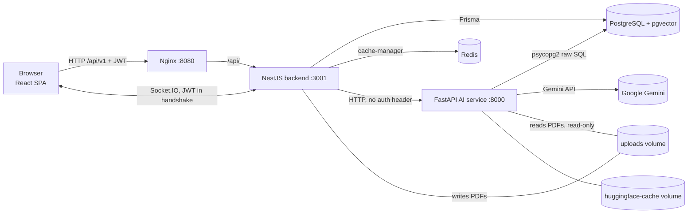

# DocLens AI — Architecture and Data Flow

> **Scope:** describes behavior verified by reading the source in this repository
> (working tree as of 2026-10-23, on top of commit `5cfb314` plus uncommitted changes).
> Nothing here was verified by running the stack unless explicitly stated.
> Items marked **⚠ Unverified** are inferred from code but were not executed.
> No secret values are reproduced in these docs; variable *names* only.

## 1. System overview

DocLens is a citation-first research assistant: users upload research-paper PDFs, organise
them (workspace → collection → document), then ask questions, compare papers, generate
literature reviews and run research-gap analysis. Answers are tied back to stored chunks.

Three application services plus PostgreSQL/pgvector and Redis (`docker-compose.yml`):

| Service | Tech | Path | Port | Role |
| --- | --- | --- | --- | --- |
| Frontend | React 19 + Vite 8 + Tailwind 4, served by Nginx 1.27 | `frontend/` | 8080→80 | SPA; nginx proxies `/api/` only |
| Backend | NestJS 11, Prisma 7 (`@prisma/adapter-pg`), Socket.IO | `backend/` | 3001 | Public REST API (`/api/v1`), auth, uploads, orchestration, persistence of chats/reviews |
| AI service | FastAPI (uvicorn, 1 worker), PyMuPDF, sentence-transformers, LangChain + Gemini | `ai-service/` | 8000 | Ingestion, embeddings, retrieval, generation, synthesis |
| PostgreSQL | `pgvector/pgvector:pg16` | compose | 5432 | App data **and** chunk vectors (single database) |
| Redis | `redis:7-alpine` | compose | 6379 | Cache backend for NestJS only (not a job queue) |



Source: `docker-compose.yml`, `frontend/nginx.conf`, `backend/src/ai-proxy/ai-proxy.service.ts`.

### Ownership split (verified)

- **NestJS** owns users, JWT, workspaces/collections/documents, upload storage, processing
  job state, chat sessions + queries + citations, comparisons, literature reviews, notes,
  reading progress. It checks ownership (`workspace.userId`) before calling the AI service.
- **FastAPI** owns PDF parsing, chunking, embeddings, hybrid retrieval, reranking, LLM calls,
  paper profiles and cross-paper synthesis. It reads/writes `Document`, `DocumentChunk`
  and `EmbeddingMetadata` rows **directly in PostgreSQL** (`ai-service/vector_store/pg_store.py`),
  bypassing Prisma. Both services therefore depend on the same table/column names.

## 2. Repository layout

```
backend/        NestJS app (src/, prisma/schema.prisma, prisma/migrations/)
ai-service/     FastAPI app (main.py, ingest.py, query.py, rag/*, vector_store/*)
frontend/       React SPA (src/, nginx.conf, Dockerfile)
docker-compose.yml, package.json (npm workspaces: frontend, backend), .env.example
docs/           this documentation
```

Module-level detail is in [FEATURES.md](FEATURES.md).

## 3. Backend structure (`backend/src`)

`main.ts` bootstrap (verified): helmet; trust-proxy 1; no static `/uploads` (PDFs only via the guarded download route); global prefix
`api/v1`; CORS from `CORS_ORIGINS`; global `ValidationPipe` (`whitelist`, `forbidNonWhitelisted`,
`transform`); `HttpExceptionFilter`; `LoggingInterceptor` + `TransformInterceptor`
(wraps every response as `{ data, meta:{timestamp,statusCode} }`); Swagger at `/api/docs`
only when `NODE_ENV !== production`; seeds one admin and one demo user at startup.

Modules (`app.module.ts`): `ConfigModule`, `CacheModule` (Redis via `@keyv/redis` when `REDIS_URL`
is set, otherwise in-memory; default TTL 60 s), `ThrottlerModule` (configured, **guard not
applied** — see limitations), `PrismaModule`, `AuthModule`, `GatewayModule`, `WorkspacesModule`,
`CollectionsModule`, `DocumentsModule`, `AiProxyModule`, `QueryModule`. `ProcessingModule` is
imported by `DocumentsModule` (not by `AppModule`). `GatewayModule` is `@Global`, which is how
`EventsGateway` reaches the processing service without an explicit import.

## 4. AI service structure (`ai-service`)

| File | Responsibility |
| --- | --- |
| `main.py` | FastAPI routes + request models; delegates to `ingest.py` / `query.py` |
| `ingest.py` | `ingest_document`, `embed_document`; lazy model loaders `get_model` (BGE-M3), `get_reranker` |
| `query.py` | Use-case wrappers with fallbacks: ask, summarise, review, compare, literature review, research gaps |
| `rag/pdf_parser.py` | Layout-aware parser → `ParsedPaper` (sections, abstract, references, captions, tables) |
| `rag/chunking.py` | Section-bounded chunks with contextual header; `finalise_chunks` (index, hash, provenance) |
| `rag/paper_profile.py` | Per-paper evidence-linked "research card" (LLM or extractive) |
| `rag/query_router.py` | Rule-based intent routing → section boosts, excluded content types |
| `rag/retriever.py` | `DocLensRetriever`: hybrid candidates → RRF → cross-encoder rerank + boost |
| `rag/chain.py` | `DocLensRAGChain`: rewrite → multi-query retrieve → structured answer → verify |
| `rag/evidence.py` | `EvidencePack`: numbered `[Evidence N]` blocks, server-side citation resolution |
| `rag/synthesis.py` | Compare / literature review / research gaps / paper summary (map-reduce) |
| `rag/verification.py` | Token-containment helpers (`claim_supported`, `containment`, …) |
| `rag/evaluation.py` | Retrieval/grounding metrics behind `POST /evaluate` |
| `rag/llm.py` | Gemini client + `invoke_structured` (native → parser → JSON-extract fallbacks) |
| `rag/schemas.py` | Pydantic models (answers, claims, profiles, gaps, review drafts, KG) |
| `rag/kg_extractor.py` | Knowledge-graph extraction — **not called by any code path** |
| `vector_store/pg_store.py`, `text_query.py` | Raw SQL access, hybrid search SQL, OR-keyword query builder |
| `reindex.py` | CLI: re-ingest + re-embed every `Document` row from `UPLOAD_ROOT` (keeps ids of unchanged chunks) |
| `internal_auth.py` | `X-Internal-Secret` check (HTTP middleware) and `INGEST_ALLOWED_DIR` path guard |
| `eval/` | `retrieval_eval.py`, `answer_eval.py`, `gold_questions.json` — offline quality harnesses |

## 5. Frontend structure (`frontend/src`)

- Entry `main.jsx` → `AuthProvider` → `App.jsx` (`AppProvider`, `ToastProvider`, `SocketProvider`).
- **Navigation is hash-based** (`#/dashboard`, `#/collections/:id`, `#/research-chat/:id`, …),
  implemented by hand in `contexts/AppContext.jsx` (`parseHash`, `buildHash`, `navigateTo`).
  There is no router library. Routes: `#/` landing (also `#features`-style in-page anchors), `#/login`,
  `#/register` (public); every other route is protected. `App.jsx` guards them: signed out + protected route →
  `#/login` (the requested route is kept in `sessionStorage` and opened after sign-in); signed in + login/register
  → that route or `#/dashboard`; signing out → `#/`. Signed-in visitors on `#/` see the landing page with an
  "Open workspace" bar. Unknown routes render the in-app 404 for signed-in users.
- Sign-in: `pages/Login.tsx` offers email/password and Google (`hooks/useGoogleSignIn.js` loads Google Identity
  Services, reads the client id from `GET /auth/config`, and sends the ID token to `POST /auth/google`).
- `components/layout/Layout.jsx`: under 900 px the sidebar becomes an off-canvas drawer (`AppContext.mobileNavOpen`,
  closed on navigation or backdrop tap); each page change replays a short enter transition (`styles/polish.css`).
  depending on `isAuthenticated`.
- All HTTP goes through `services/api.ts` (base URL `VITE_API_URL`, default
  `http://localhost:3001/api/v1`; token in `localStorage['doclens_token']`; unwraps `json.data`).
- `contexts/SocketContext.jsx` opens a Socket.IO connection and `join:collection` rooms to
  receive `document:*` events.

## 6. Key data flows

### 6.1 Upload → READY

```mermaid
sequenceDiagram
  participant U as Browser
  participant BE as NestJS
  participant DB as PostgreSQL
  participant AI as FastAPI
  U->>BE: POST /documents/upload (multipart file + collectionId, JWT)
  BE->>BE: multer: PDF only, ≤50 MB, saved to uploads/<userId>/<ts>-<rnd>.pdf
  BE->>DB: Document(status=PENDING) ; emit document:uploaded
  BE-->>U: 201 Document
  BE->>DB: ProcessingJob(QUEUED, maxAttempts=1) ; run in-process (not awaited)
  BE->>AI: POST /ingest {documentId, filePath, collectionId}
  AI->>AI: parse_paper → build_chunks → build_profile
  AI->>DB: DELETE+INSERT DocumentChunk (no vectors) ; UPDATE Document.metadata/title/pageCount
  BE->>DB: Document=EMBEDDING(70%) ; emit document:status
  BE->>AI: POST /embed {documentId}
  AI->>DB: UPDATE DocumentChunk.embedding (1024-d) ; UPSERT EmbeddingMetadata
  BE->>DB: Document=READY(100%), ProcessingJob=COMPLETED ; emit document:status
```

Verified in `backend/src/documents/documents.service.ts`, `backend/src/processing/document-processing-queue.service.ts`,
`ai-service/ingest.py`. Any exception sets `Document.status=FAILED` + `errorMessage` and the job to
`FAILED` (no retry; `maxAttempts` is 1). The backend progress values written are 20 (EXTRACTING),
70 (EMBEDDING), 100 (READY); the `CHUNKING`/`INDEXING` enum values exist but this runner does not set them.

### 6.2 Question answering

```mermaid
sequenceDiagram
  participant U as Browser
  participant BE as NestJS QueryService
  participant AI as FastAPI
  participant DB as PostgreSQL
  U->>BE: POST /query/ask/stream {question, collectionId, documentIds?, topK?, clientRequestId}
  BE-->>U: SSE stage: queued
  BE->>BE: assert collection access ; documentIds ⊂ collection (else 403) ; resolve/create ChatSession ; last 20 queries as history
  BE->>BE: same clientRequestId in flight → join it ; already stored → replay it
  BE->>AI: POST /ask/stream {question, collectionId, documentIds, topK, history} + X-Internal-Secret (timeout 180 s)
  AI->>AI: rewrite (if history) → route → facet candidates → RRF → ONE rerank → Gemini (60 s, 1 retry) → resolve [Evidence N] → verify claims
  AI-->>BE: SSE stage events (relayed to the browser), then result: answer, citations, claims, confidence, insufficient_evidence, timings_ms
  BE->>DB: alignAiCitations: load cited chunks within user/collection/document scope ; drop the rest ; renumber [n]
  alt AI /ask fails (incl. no Gemini key)
    BE->>AI: POST /search (skipped after a timeout) or local keyword ranking over up to 2000 chunks
    BE->>BE: composeCitedAnswer(): labelled "AI answer service is unavailable…" passages, each citing its own source
  end
  BE->>DB: persist Query + Citation rows (zero citations only when insufficient_evidence)
  BE-->>U: SSE result: answer + citations (or error {statusCode, message})
```

Nginx serves `/api/v1/query/ask/stream` with `proxy_buffering off` so stage events reach the browser at once. The chat page shows the
current stage and elapsed seconds, offers Cancel (closing the stream aborts the backend → AI chain; nothing is persisted), ignores
responses that belong to an older question or session, and falls back to `POST /query/ask` if the stream route returns 404.

Verified in `backend/src/query/query.service.ts` (`ask`, `alignAiCitations`, `retrieveEvidence`, `composeCitedAnswer`)
and `ai-service/query.py`, `rag/chain.py`; covered by `query.service.spec.ts` with fakes (not against a live stack).
The backend no longer runs a separate `/search` before `/ask`; it retrieves on its own only in the fallback path.

### 6.3 Comparison / literature review / research gaps

Backend validates access, calls the AI endpoint (`/compare`, `/literature-review`, `/research-gaps`),
normalises citations against stored chunk ids, and (for compare and review) persists the result
(`PaperComparison`, `LiteratureReview`). Research-gap results are **returned but not persisted**.
Compare and review fall back to backend-local logic if the AI call fails
(`compare`: keyword-ranked bullets; `literature review`: per-section `/ask` loop, then local text).

### 6.4 Real-time status

`EventsGateway` (Socket.IO, default namespace): the handshake must carry a valid JWT in
`auth.token` or the socket is disconnected. Clients emit `join:collection` (membership verified via
`collection.workspace.userId`) and receive `document:uploaded`, `document:status`, `document:deleted`
on room `collection:<id>`.

## 7. Network and deployment boundaries

- Browser-facing: Nginx `:8080`, and also backend `:3001` and AI `:8000` are **published** by compose.
- The AI service is not proxied by Nginx. It requires `X-Internal-Secret` when `INTERNAL_API_SECRET` is set (see [API.md](API.md));
  compose still publishes port 8000 for local development.
- Startup order: postgres/redis healthy → `backend-migrate` (`prisma migrate deploy`) → ai-service healthy
  (180 s start period for model download) → backend healthy → frontend.
