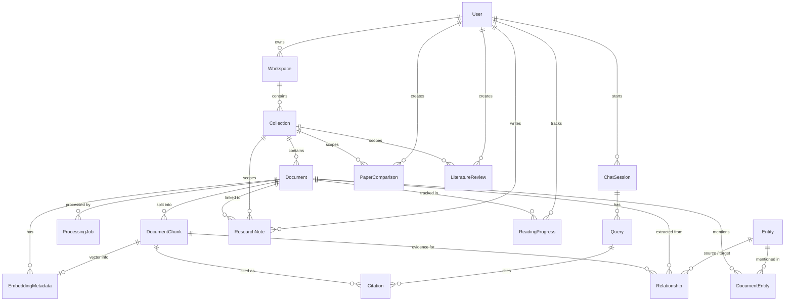

# DocLens AI — Database Schema and Relationships

> Source of truth: `backend/prisma/schema.prisma` (421 lines) and `backend/prisma/migrations/`.
> PostgreSQL 16 with the `vector` extension (`pgvector/pgvector:pg16`). Verified by reading the schema,
> migrations and the AI service's raw SQL (`ai-service/vector_store/pg_store.py`). No live database was queried.

## 1. Access pattern

- **Backend (Prisma)** reads/writes everything via `@prisma/client` with the `pg` adapter.
- **AI service (psycopg2 raw SQL)** also reads/writes `Document` (title, `pageCount`, `metadata`),
  `DocumentChunk` (content, metadata, `embedding`) and `EmbeddingMetadata`, and reads `Entity`/`Relationship`.
  Column names are quoted camelCase (`"documentId"`, `"chunkIndex"`), so a Prisma rename would break the AI service.
- Connection string: `DATABASE_URL` for both services (no value recorded here).

## 2. Entity-relationship diagram

`ChatSession.scopeId`, `ResearchNote.scopeId`, `Entity.collectionId`, `Relationship.collectionId`,
`EmbeddingMetadata.collectionId` and `AnalyticsSnapshot.scopeId` are plain string columns, **not** foreign keys.

## 3. Models

### Core hierarchy
| Model | Key fields | Notes |
| --- | --- | --- |
| `User` | `email` (unique), `name`, `passwordHash`, `role` (string: `admin`/`viewer`, default `viewer`), `googleId` (nullable, unique: the Google `sub` the account is linked to; migration `20261025000000_user_google_id`; stripped from API profiles), `hasPassword` (boolean, default `true`; `false` for accounts created with Google that never set a password; migration `20261026000000_user_has_password`) | Cascade-deletes workspaces, sessions, comparisons, reviews, notes, progress |
| `Workspace` | `name`, `description?`, `userId` | Ownership root for authorization |
| `Collection` | `name`, `description?`, `workspaceId` | Cascade from workspace |
| `Document` | `title`, `filename`, `fileUrl` (relative, `uploads/<userId>/<file>`), `mimeType`, `fileSize?`, `pageCount?`, `status`, `processingProgress`, `errorMessage?`, `metadata` (JSON), `aiProcessedAt?`, `collectionId` | See §4 for `metadata` contents |

`DocumentStatus` enum: `PENDING, UPLOADED, EXTRACTING, CHUNKING, EMBEDDING, INDEXING, READY, COMPLETED, FAILED`.
The processing runner only writes `PENDING → EXTRACTING → EMBEDDING → READY` (or `FAILED`).
`COMPLETED` is handled by `DocumentsService.updateStatus`, but that method has no callers, and the current runner never produces it.

### Evidence and vectors
| Model | Key fields | Notes |
| --- | --- | --- |
| `DocumentChunk` | `content`, `pageNumber?`, `chunkIndex`, `tokenCount?` (word count), `contentHash?` (sha256), `metadata` (JSON), `embedding vector(1024)?`, `vectorId?`, `documentId` | Unique `(documentId, chunkIndex)`; index `(documentId, pageNumber)`. `embedding` is a Prisma `Unsupported` type, written only by the AI service. `vectorId` on the chunk is not set by the code paths read; `EmbeddingMetadata.vectorId` is |
| `EmbeddingMetadata` | `provider`, `modelName`, `dimensions`, `similarityMetric` (`cosine`), `vectorStore` (`pgvector`), `vectorId` (unique, `pgvector:<chunkId>`), `collectionId`, `chunkId` (unique), `documentId` | One row per embedded chunk; upserted on `chunkId` |

Vector index (migration `20260916000000_fix_document_chunk_vector_schema`): HNSW
`DocumentChunk_embedding_hnsw_idx` on `embedding vector_cosine_ops` (`m=16`, `ef_construction=128`).
That migration also altered the column from `vector(384)` to `vector(1024)` and **set existing embeddings
to NULL** (re-embedding required after applying it to old data).

Keyword search uses `to_tsvector('english', content)` computed at query time. **No GIN/FTS index exists in
any migration** (searched all `migration.sql` files), so keyword retrieval scans the filtered rows.

### Conversations and generated artifacts
| Model | Key fields |
| --- | --- |
| `ChatSession` | `title?`, `scopeType` (`collection`), `scopeId`, `userId` |
| `Query` | `question`, `answer?` (Text), `modelUsed?`, `retrievalMode` (`vector`), `processingMs?`, `rawRequest` (JSON), `chatSessionId` |
| `Citation` | `relevance?`, `pageNumber?`, `documentTitle?`, `sourceText?` (Text), `queryId`, `chunkId` → `DocumentChunk` (cascade). Re-ingest keeps chunk ids for unchanged text so these rows survive; citations of chunks whose text changed are still deleted by the cascade |
| `PaperComparison` | `title`, `question?`, `documentIds[]`, `result` (JSON), `markdown?`, `userId`, `collectionId?` (SetNull) |
| `LiteratureReview` | `title`, `topic?`, `documentIds[]`, `sections` (JSON), `markdown`, `status`, `userId`, `collectionId?` (SetNull) |
| `ResearchNote` | `title`, `content`, `scopeType`, `scopeId`, `userId`, `collectionId?`, `documentId?` |
| `ReadingProgress` | `status` (`UNREAD`…), `progress`, `lastReadPage?`, `notes?`; unique `(userId, documentId)` |

Research-gap analysis results have **no table**.

### Processing
`ProcessingJob`: `queueName` (`document-processing`), `status` (`QUEUED/ACTIVE/RETRYING/COMPLETED/FAILED/DEAD_LETTER`),
`stage` (`UPLOADED…READY/FAILED`), `progress`, `attempts`, `maxAttempts` (runner sets 1), `payload`, `errorMessage`,
timestamps (`startedAt`, `completedAt`, `failedAt`, `lastHeartbeatAt`). `RETRYING` and `DEAD_LETTER` are never set by current code.

### Knowledge-graph tables (schema only)
`Entity` (`type`: AUTHOR/CONCEPT/DATASET/METHOD/METRIC/MODEL/PAPER; unique `(collectionId, normalizedName, type)`),
`DocumentEntity`, `Relationship` (12 `RelationshipType` values, optional `evidenceChunkId`). The AI service can
**read** them; nothing in the ingestion path **writes** them (`rag/kg_extractor.py` and `pg_store.insert_entities/insert_relationships`
are not called by any module — grep verified). `documents.service.ts › persistAiOutputs` (which could write entities) has no caller.

`AnalyticsSnapshot`: defined, unused by the code read.

## 4. JSON fields written by the AI service

### `Document.metadata` (merged by `update_document_ingest_metadata`; keys from `ingest.py`)
`title, authors[], page_count, wordCount, readingTimeMinutes, extractor, chunkCount, evidenceTypes[], abstract (≤3000 chars),
outline[{heading,type,level,page}], referenceCount, profile (PaperProfile), profileMethod ("llm"|"extractive"), vectorStore`.
The document `title` column is also overwritten with the detected title (unless it is "untitled"/"unknown").

### `DocumentChunk.metadata` (from `rag/chunking.py` + `finalise_chunks`)
Common: `extractor, content_type, section, section_path, section_type, section_level, source_page, page_start, page_end,
source_part_index, paper_id, collection_id, chunk_index`.
`content_type` values written: `section_text, abstract, front_matter, table, figure, table_caption, reference,
paper_profile` (+ `page_text` in the page-level fallback). `section_type` values: see [RAG_PIPELINE.md](RAG_PIPELINE.md) §2.
Table chunks add `caption`; reference chunks add `reference_range`; figure/caption chunks add `caption`, `label`.

## 5. Migrations (`backend/prisma/migrations`)

| Migration | Purpose |
| --- | --- |
| `20260413103823_init` | Base tables/enums (old default `vectorStore='faiss'`, later changed) |
| `20260524090000_research_intelligence` | Comparisons, literature reviews, notes, reading progress, `retrievalMode` default |
| `20260604000000_pgvector` | `vector` extension, `embedding vector(384)`, HNSW index |
| `20260916000000_fix_document_chunk_vector_schema` | `metadata JSONB`, embedding → `vector(1024)` (data cleared), HNSW rebuilt, `vectorStore` default `pgvector` |
| `20261025000000_user_google_id` | `User.googleId` (nullable, unique) |
| `20261026000000_user_has_password` | `User.hasPassword BOOLEAN NOT NULL DEFAULT true` (existing users keep `true`). Applied on the Docker stack 2026-10-26 |

Applied in Docker by the `backend-migrate` service (`npx prisma migrate deploy`). **⚠ Unverified:** whether the
migration history matches `schema.prisma` exactly (no `prisma migrate diff` was run); `DocumentChunk.metadata` is
added only by the last migration via raw SQL.
