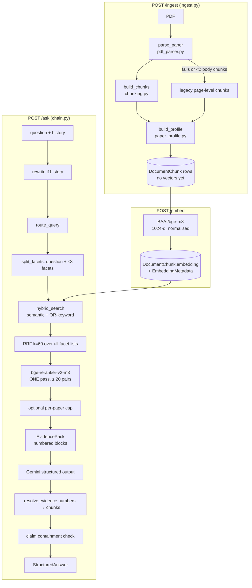

# DocLens AI — RAG Pipeline: Ingestion, Retrieval, Generation, Citations

> Verified by reading `ai-service/` source; updated 2026-10-23 after the accuracy audit and the latency / retuning pass. Offline
> tests were run (§10); quality and latency were measured with BGE-M3 + bge-reranker-v2-m3 on CPU and live Gemini (§11). Not
> verified: the pgvector SQL against a real database (no PostgreSQL was available). Numeric constants are code defaults; Docker
> Compose can override several via env.

## 1. End-to-end overview

## 2. Ingestion (`POST /ingest`)

Entry: `ingest.ingest_document(document_id, file_path, collection_id)`.

1. **File check.** Missing file → `{status:"failed", message}` (the backend turns a non-`completed` status into a `FAILED` document).
2. **Layout parse** — `rag/pdf_parser.py › parse_paper` (PyMuPDF, `get_text("dict", sort=True)`):
   - Per line: text (NFKC-normalised), max font size, bold ratio (flag bit 16 or "bold" in font name, ≥ 80 % of chars), bbox.
   - **Running headers/footers and page numbers** removed: lines in the top/bottom 8 % of the page whose digit-normalised text
     repeats on ≥ `max(3, 40 % of pages)` pages (only when the PDF has ≥ 3 pages); bare page numbers in margins are dropped.
   - **Headings** by typography (larger than body size by ≥ 1 pt, or bold, or numbered such as `3.2 Method` / `IV.` / `A.`) plus a
     vocabulary of known names; rejects lines with `@`, `=`, URLs, `et al`, or long/terminal-punctuation text.
   - **Section types** (`SECTION_TYPES`): `front_matter, abstract, introduction, related_work, background, method, experiments, results,
     discussion, limitations, conclusion, future_work, acknowledgements, back_matter, references, appendix, other`. A heading maps to a type via ordered
     regexes (first match wins). Unrecognised headings inherit the previous typed section (or `front_matter` before the body starts).
   - **Title:** largest first-page text in the top half, used only if PDF metadata title is missing/short/looks like a filename; otherwise the metadata title.
   - **Abstract:** "Abstract" heading, an inline `Abstract—…` line, or the first front-matter paragraph ≥ 400 chars on pages 1–2.
   - **References:** the `references` section split into entries (`[n]` style, or `12. Author,` style), entries ≥ 20 chars.
   - **Captions** (`Figure|Fig|Table N …`, ≥ 15 chars) and **native tables** (`page.find_tables()` → Markdown, ≥ 80 chars; best effort).
   - Authors come from PDF metadata only (split on `;`, `,`, `and`).
3. **Chunking** — `rag/chunking.py › build_chunks`:
   - Chunks never cross a section boundary. Paragraphs are packed up to `CHUNK_MAX_CHARS` (default **2000**), with overlap of whole trailing sentences
     within `CHUNK_OVERLAP_CHARS` (default **300**). A body section whose whole text is under `MIN_CHUNK_CHARS` (**120**) is **carried** into the next
     section's first chunk as `"<heading>: <text>"` (or appended to the last body chunk), never dropped (fixed 2026-10-23: lead-in lines such as
     "We employ three types of regularization" were silently lost). A short trailing piece inside a section is merged into the previous piece.
   - Each chunk text is prefixed with a **contextual header** `Paper: <title>` and `Section: <path>` (this header is embedded together with the text).
   - Separate chunks for: every table (header + page + caption + Markdown, `section_type=results`), figure / table captions
     (`figure` / `table_caption`), and reference groups of 8 (`reference`, `section_type=references`).
   - `finalise_chunks` assigns `chunkIndex`, sha256 `contentHash`, and `paper_id` / `collection_id` metadata.
4. **Re-ingest keeps ids** — `reconcile_chunk_ids` runs *before* profiling: a chunk whose `contentHash` matches a stored chunk takes over that
   row's id, so `Citation` rows (which cascade-delete with their chunk) survive `reindex.py`. Its vector is kept only if `EmbeddingMetadata.modelName`
   equals the current `EMBEDDING_MODEL`; otherwise it is nulled for re-embedding. `insert_ingestion_chunks` is an upsert: kept rows are moved to
   negative `chunkIndex` first (unique key), unmatched old rows are deleted (their citations cascade, because that text no longer exists).
4. **Fallback.** If the parser raises, or fewer than 2 chunks are neither `reference` nor `front_matter`, the service uses `ingest._legacy_page_chunks`
   (page text with a heuristic "section" line, plus the already extracted reference chunks). With Docker's env both chunkers read the same
   `CHUNK_MAX_CHARS` variable, but **without** that env the legacy path defaults to 3600/450 characters while the main path defaults to 2000/300.
   Scanned/image-only PDFs have no OCR; with no extractable text the call returns `failed`.
5. **Paper profile** — `rag/paper_profile.py › build_profile` (never raises):
   - If `PAPER_PROFILE_ENABLED` (default true) **and** `GEMINI_API_KEY` is set (not a `REPLACE_WITH…` placeholder): picks section-prioritised evidence within
     `PROFILE_CONTEXT_CHARS` (28000) and asks Gemini for a `PaperProfile` (problem, type, domain, contributions, methods, datasets, metrics,
     key results, baselines, limitations, assumptions, future work, keywords). Each item carries an `evidence_number` and quote; `_ground` resolves it to a
     chunk id and sets `grounded` only if the quote (≥ 0.6 token containment) or the text (≥ 0.4) is found in that chunk.
   - Otherwise (or on error): an **extractive** profile from cue-word sentences in the matching section types.
   - The profile is stored in `Document.metadata.profile` and also persisted as a retrievable chunk with `content_type=paper_profile`, `section_type=profile`.
6. **Persist.** `pg_store.insert_ingestion_chunks` deletes all existing chunks of the document and inserts the new ones inside one transaction (no embeddings);
   `update_document_ingest_metadata` merges metadata and updates `title` / `pageCount`.

Vision/OCR: `VISION_ENABLED` / `VISION_MAX_PAGES` appear in `.env.example` and compose but **no code reads them** (grep verified).

## 3. Embedding (`POST /embed`)

`ingest.embed_document`: loads chunks with `embedding IS NULL`, encodes with `SentenceTransformer("BAAI/bge-m3")` (`EMBEDDING_MODEL`),
batch size `EMBED_BATCH_SIZE` (16), `normalize_embeddings=True`. The loader raises if the model's dimension is not **1024**.
Vectors are written with `UPDATE "DocumentChunk" SET embedding`, and `EmbeddingMetadata` is upserted (cosine, `pgvector`).
Because only un-embedded rows are processed, re-calling `/embed` is idempotent; re-calling `/ingest` replaces all chunks (and therefore drops vectors).

## 4. Query routing (`rag/query_router.py`)

Pure regex, no LLM. Intents in order: `limitations, gaps, method, data, results, contribution, related, conclusion`. Each intent maps to
section-type weights (e.g. `limitations → {limitations 1.0, discussion 0.6, conclusion 0.4, future_work 0.4}`); secondary intents count half.
Default excluded content types: `reference`, `front_matter` (only `front_matter` when the intent is `related`).
Cross-paper words (compare, versus, across papers, trend…) or a `contribution` intent set `prefer_profiles` and boost `profile` chunks.
Final boost added to the reranker score: `SECTION_BOOST × weight`, where `SECTION_BOOST` comes from `ROUTER_SECTION_BOOST` and
**defaults to 0 (off)**. With the real cross-encoder every non-zero value tried lowered Recall@5 on the validation set (§11), so the
router now only filters content types (references, front matter) and marks profile preference.

## 5. Retrieval (`rag/retriever.py`, `vector_store/pg_store.py`)

`DocLensRetriever.retrieve_chunks(query)` = `rerank(query, candidates(query))`; `retrieve_multi(queries, rerank_query, …)` (used by `/ask`)
gathers candidates for every facet and reranks **once**:
1. Embed the query with BGE-M3 (≈ 0.2 s on CPU).
2. `pg_store.hybrid_search` runs **one SQL** returning two independent ranked lists, each `LIMIT rerank_top_k` (`RERANK_CANDIDATES`, default **20**; was 40):
   - *semantic:* `ORDER BY embedding <=> query_vector` over rows with an embedding;
   - *keyword:* `to_tsvector('english', content) @@ websearch_to_tsquery('english', q)` ranked by `ts_rank_cd`, where `q` is built by
     `text_query.keyword_or_query` (stopwords removed, ≤ 16 terms, joined with ` or ` so natural-language questions can still match).
   - Scope filter (`text_query.scope_filter`): `d."collectionId" = collectionId AND d.id = ANY(documentIds)` — document ids are always intersected
     with the collection when both are given; a call with neither raises (previously `WHERE TRUE`). Excluded content types are filtered out in both lists.
   - The semantic list only compares against vectors whose `EmbeddingMetadata.modelName` equals the current `EMBEDDING_MODEL`, so a model change
     cannot mix vector spaces (un-reindexed chunks stay reachable by keyword).
3. `reciprocal_rank_fusion` (Python): `score = Σ 1/(60 + rank)` per list (all lists of all facets); keeps `retrieval_sources`; keeps the top `rerank_top_k`.
4. **Cross-encoder rerank, one `predict` call:** `CrossEncoder("BAAI/bge-reranker-v2-m3", max_length=RERANKER_MAX_LENGTH)` (default 512 tokens;
   the model's own default is 8192, and section chunks average ≈ 350 tokens per pair, max ≈ 670 measured) scores `[question, chunk]` → `sigmoid`;
   `score = min(1, rerank + section_boost)` (boost 0 by default). `RERANKER_ENABLED=false` skips the cross-encoder and ranks by normalised RRF.
5. `cap_per_document(max_per_document)` for diversity; return top `top_k`.

`balanced_retrieve` (used by synthesis) gathers candidates per paper for every query and reranks once per paper against the joined queries,
so every paper is represented (before: one rerank per paper × query).

Models are loaded once per process behind a lock (`ingest.get_model` / `get_reranker`); the FastAPI startup hook warms both in a background
thread (`MODEL_WARMUP`, default true) and `/health` reports `models_loaded`.
`pg_store.search` (older single-SQL RRF using `plainto_tsquery`) is no longer called; `/evaluate` uses the production retriever (see §9).

## 6. Generation for Q&A (`rag/chain.py`, `query.py`)

1. **Rewrite** (only when `history` is non-empty): LLM turns the follow-up into a standalone question; failures fall back to the original.
2. **Facets:** `split_facets` splits on `and/also/while/versus/vs/?/;` into ≤ 3 facets of ≥ 3 words (+ the full question). Candidates of every facet
   are fused and reranked once against the full question (`retrieve_merged` → `retrieve_multi`); top `max(top_k, 10)` kept. Before 2026-10-23 each facet
   was reranked separately (up to 4 × 40 cross-encoder pairs per question).
3. Per-paper cap in `DocLensRAGChain.create`: none for a single selected document, else `max(3, top_k // 2)`.
4. **EvidencePack** formats blocks: `[Evidence N] paper="…" page=… section="…" type=…` + body (contextual header stripped; ≤ `CHUNK_MAX_CHARS +
   CHUNK_OVERLAP_CHARS + 500` = 2800 chars per block, i.e. the whole chunk; it was 1800 before 2026-10-24, which hid the end of long chunks from
   the model while verification used the full text).
5. **Gemini** (`rag/llm.py`, default model `gemini-2.5-flash`, temperature 0.1) with `invoke_structured(AnswerDraft, …)`:
   native `with_structured_output` → `PydanticOutputParser` → raw-JSON extraction as fallbacks. System prompt rules: answer strictly from evidence,
   cite every factual sentence as `[Evidence N]`, list claims with `evidence_numbers`, set `insufficient_evidence` rather than guess, keep numbers verbatim.
6. **Relevance floor (2026-10-24).** Retrieval now carries each semantic hit's BGE-M3 cosine (`similarity`, from pgvector `1 - (embedding <=> q)`;
   RRF keeps the best value per chunk; `top_scores()` returns `top_similarity` and, only when the cross-encoder actually ran, `top_rerank`). If no
   chunk is retrieved, or `top_similarity < RETRIEVAL_MIN_SIMILARITY` (default 0.48), the chain **abstains without the answer prompt**:
   `insufficient_evidence=true`, `abstain_reason` `no_chunks` / `low_relevance`, no citations. It then makes one small `BackgroundDraft` call: if
   Gemini judges the question to be general knowledge (a definition, a widely known fact), its short reply is returned as `background`, which
   is never cited and is shown separately as "general knowledge, not from your papers". Any failure of that call means no background, not an
   error. `RETRIEVAL_MIN_RERANK` (cross-encoder floor) exists but defaults to 0 (off): it was not calibrated (see §11).
   Calibration (`eval/abstention_calibration.py`, 12 local PDFs, 28 answerable gold/validation questions, 16 hand-written unanswerable ones in
   `eval/unanswerable_questions.json`): answerable top cosine 0.552–0.746; off-topic 0.349–0.433; questions *about* the papers whose answer is
   absent 0.531–0.658. So the floor catches off-topic questions (6/6 at 0.48, 0 answerable lost) but **not** in-domain unanswerable ones
   (0/10); those still rely on the prompt rules, `opens_with_refusal` and claim checks. Measured on the in-memory index with the same model
   and normalised vectors as pgvector; the live pgvector values were not compared question by question.
7. **LLM errors and a missing `GEMINI_API_KEY` now raise**
   (HTTP 500 from `/ask`); the old free-text fallback that returned "GEMINI_API_KEY is not configured…" as an answer was removed. The backend then shows
   its labelled extractive fallback (see §7).
8. The prompt also tells the model to state disagreements between evidence blocks, cite each side and set `evidence_conflict=true`; the
   answer then carries `evidence_conflict` and its confidence is multiplied by 0.8. Rule 9 forbids facts from memory in `answer`; rule 10 allows
   an optional `background` (≤ 3 sentences, general concepts only, no paper results or markers; any `[Evidence N]` in it is stripped by
   `clean_background`). Background text is outside `answer`, so it never counts as an uncited sentence.
9. **Time limits:** the Gemini client gets `timeout=LLM_TIMEOUT_S` (60 s) and `max_retries=LLM_MAX_RETRIES` (1); langchain's defaults were no
   timeout and 6 retries. A timeout, an exhausted quota / rate limit (429 `ResourceExhausted`) or a rejected key (`llm_error_kind`) is re-raised
   instead of triggering the parser fallback, which would be a second call that fails the same way.
   `DocLensRAGChain.invoke` records per-stage milliseconds (`rewriting`, `retrieving`, `generating`, `verifying`) and `/ask` returns them with
   `setup` and `total` as `timings_ms`.
10. **Streaming:** `POST /ask/stream` runs the same `ask_question` in a worker thread and sends Server-Sent Events: `stage` (`loading_models`,
   `rewriting`, `retrieving`, `background` (abstention path only), `generating`, `verifying`), then one `result` (the `/ask` JSON) or one `error` (`{detail}`); a comment line
   every 10 s keeps proxies open. When the client disconnects, the run stops at the next stage boundary (a Gemini call already in flight finishes).
   Answer tokens are **not** streamed: the structured answer is only shown after its evidence numbers are resolved and claims checked.

## 7. Citation resolution and claim verification

*Citations.* The model never writes chunk ids. `build_structured_answer` collects every `[Evidence N]` in the answer and in `claims[].evidence_numbers`,
keeps only numbers that exist in the pack, orders them by first use, and builds `CitationRef` objects **from the stored chunk** (`chunk_id`, `document_id`,
title, page, rerank score) with `source_text` = the ≤ 600-char window of consecutive sentences that best covers the answer sentences / claim citing
that block (`evidence.best_window`; previously the chunk's first 600 chars, which held the supporting passage for only 0.40–0.78 of eval questions).
Inline markers are rewritten `[Evidence 4, 9]` → `[1][2]`. A citation therefore cannot point at a chunk that was not in the prompt.

*Claims.* For each claim, a cited chunk "supports" it when `check_claim(claim, full_chunk_text)` passes: **every number in the claim** must occur in
the chunk (`verification.missing_numbers`; `1,024`→`1024`, `93.2%`→`93.2`, spelled-out numbers in the chunk count, digits inside names such as `GPT-3`
are ignored); then fewer than 3 content tokens ⇒ supported; otherwise ≥ **45 %** of the claim's content tokens (stop-words removed) must occur in the
chunk (`verification.containment`). `verified = any supporting chunk`. `unsupported_claim_rate` lowers the reported `confidence`
(`confidence × (1 − 0.5·rate)`). Unsupported claims are **flagged, not removed**: the answer ends with `Note: X of Y claims … could not be matched to the
cited passages (N state numbers that do not appear in their cited passages)…`. Content sentences (≥ 6 content words) with **no** `[Evidence N]` marker
are counted as `uncited_sentences` and noted too ("N sentence(s) carry no citation…"). `insufficient_evidence` is forced true when no valid citation
survives or the answer's first sentence is a refusal ("not mentioned", "does not contain", …; `chain.opens_with_refusal`).

*Backend (NestJS) side* — `QueryService.alignAiCitations` resolves AI citations with **one** Prisma query restricted to the request scope
(user → collection → selected documents). Out-of-scope or missing chunks are dropped, never replaced by other evidence, and `[n]` markers in the
answer / sections / gap texts are renumbered (`remapMarkers`) so `[n]` always equals position `n` in the returned list. If the AI service fails, `/query/ask`
runs its own retrieval and returns a fallback whose text starts "The AI answer service is unavailable…", with each line citing exactly the passage it
quotes (`composeCitedAnswer`; the old `composeAnswer` cited a different order than it showed). An uncited answer is persisted only when it is marked
`insufficient_evidence` (`persistQuery({ allowUncited })`).

This is lexical containment, not entailment: a claim can pass while being semantically wrong. `validate_citations`, `verify_claims` and `verify_single_claim` in
`verification.py` are not called by `chain.py` or `synthesis.py`: `validate_citations` is referenced only by a test, and `verify_claims` has no callers
(grep verified). The README's "citation overlap validation" is therefore achieved by server-side resolution of evidence numbers plus the claim containment check above.

## 8. Multi-paper synthesis (`rag/synthesis.py`)

Shared shape: **map** (per-paper profiles via `load_papers`; a missing profile is built on demand and cached into `Document.metadata`) → **gather**
(balanced retrieval + the chunks that ground each profile item, interleaved across papers, max 48 blocks) → **reduce** (one structured Gemini call over
numbered evidence) → **resolve** (evidence numbers → real chunks; `_CitationIndex` makes `[n]` match the final source list, and shows the passage
window that best matches the citing sentences) → **verify** (`SynthesisVerifier`, below).

Only **grounded** profile items (quote/text found in the cited chunk at ingest) reach paper cards, the comparison matrix, the coverage report,
summaries and extractive fallbacks. Per-paper retrieval shares a cross-encoder budget (`SYNTHESIS_RERANK_BUDGET`, 60 pairs per task): each paper's
pool is `min(RERANK_CANDIDATES, max(kept, budget // papers))`, and when that equals the number of chunks kept the cross-encoder is skipped for that
paper (fused RRF order). Candidates are reranked against the task's question / topic, not the joined queries. The Gemini call uses
`SYNTHESIS_LLM_TIMEOUT_S` (100 s).

*SynthesisVerifier* (lexical, per sentence of the raw draft): `supported` = its cited passages (concatenated) pass `check_claim`; `misattributed` =
it names a paper by title (full title, or the part before ":" if ≥ 3 words) but cites no passage from that paper and no cited passage mentions it;
`uncited` = a content sentence with no marker ("… not reported" excluded). Each output carries `verification {checked, supported, unsupported,
misattributed, uncited, issues[≤25]}`; review sections carry their own counts and the review Markdown starts with a one-line verification note.
Gaps get `support`: `stated` (a cited sentence, or the description, is found in the cited passages), `inferred` (cited but argued; confidence capped at
0.7) or `ungrounded` (no valid citation; capped at 0.3). Contradiction positions get `verified` (stance found in its passage) and
`attributionMismatch` (the LLM's paper title differs from the cited passage's paper).

| Task | Endpoint | Output highlights |
| --- | --- | --- |
| Comparison | `/compare` (≥ 2 papers) | per-paper methods/datasets/strengths/weaknesses/findings/future work, agreements, disagreements, `paperMatrix` |
| Literature review | `/literature-review` | 7 fixed sections (`introduction, existingApproaches, commonMethodologies, keyFindings, limitations, researchGaps, futureDirections`), themes, comparison matrix, Markdown with a Sources list |
| Research gaps | `/research-gaps` | gaps (typed, ranked, `grounded` flag, confidence capped at 0.3 when ungrounded), consensus, contradictions, deterministic **coverage report** (datasets/metrics/methods per paper), matrix |
| Summary | `/summarise` | built from profile items that are grounded (no LLM call) |
| Review | `/review` | routed retrieval + Gemini free text (`[Citation N]`) through the bounded client, **no** structured verification |

Without `GEMINI_API_KEY` (or if the LLM call fails) each task degrades to a deterministic extractive result built from the profiles (`method: "extractive"`).
Note `/review` and the NestJS-side fallbacks use plain text generation and are not claim-verified.

## 9. Evaluation (`rag/evaluation.py`, `POST /evaluate`)

Runs the real `ask_question` and re-fetches chunks with `chain.production_retriever` + `retrieve_merged` (the same retriever, facets and merge as
`/ask`), then computes: `recall_at_k` and `mrr` (only if `relevantChunkIds` supplied), `faithfulness` (sentence containment ≥ 0.5, heuristic),
`answer_relevance` (Gemini 0–1 via `rag/llm.model_name()`; token-overlap heuristic if no key), `citation_correctness`, `citation_precision`,
`citation_coverage`, `unsupported_claim_rate`, `latency_ms`; `isNegativeTest` asserts `insufficient_evidence` or low confidence.

Offline harnesses (no PostgreSQL) over real PDFs with known supporting passages (`ai-service/eval/gold_questions.json`, 16 questions on
BERT, Transformer, GPT-3 and a COVID-19 smartwatch paper; the PDFs are local uploads and are not in git):
- `python ai-service/eval/retrieval_eval.py [--model M] [--reranker R] [--pool N] [--reranker-max-length L]` — Recall@5, MRR@10, gold coverage,
  citation-window hit rate. Ranking goes through the production `DocLensRetriever.retrieve_multi` (facets, RRF, one rerank, per-paper cap); only the
  candidate store is an in-memory index (BM25 instead of `ts_rank_cd`). Default configs: legacy page chunks, section chunks, section + router (boost
  off, the default), section + router boost 0.08 (old default), and pool 40.
- `... --gold eval/validation_questions.json --tune` — sweeps boost {0, 0.02, 0.04, 0.08} × pool {10, 20, 40} on the **validation set**
  (12 questions, disjoint from the 16-question gold/test set). Tune there, report on `gold_questions.json`.
- `python ai-service/eval/latency_bench.py --questions 6 [--llm N]` — retrieval wall time per question, old path (per-facet rerank, pool 40,
  max_length 8192) vs new path, and with `--llm` full-chain stage timings with live Gemini.
- `python ai-service/eval/answer_eval.py` — live Gemini: gold passage cited, citations resolve, claim verification rate, negative questions flagged.

## 10. Tests (run 2026-10-23)

`python -m pytest ai-service/rag -q` → **77 passed** (system Python 3.13; pgvector is stubbed where needed). Files: `test_phase_pipeline.py`,
`test_research_pipeline.py`, `test_synthesis_integration.py`, `test_audit_regressions.py` (scope filter, internal secret + middleware, ingest path guard,
chunk-id reconciliation, short-section carry, citation windows, unverified-claim note, refusal detection, LLM failure raises),
`test_latency_streaming.py` (single rerank per question / per paper, reranker-off fallback, bounded Gemini timeout/retries, no retry after timeout,
`/ask/stream` stages + result + error + 401, chain stage timings), `test_pipeline_review.py` (number-aware claim checks, uncited sentences, full-size
evidence blocks, synthesis verifier and attribution, citation windows in synthesis, grounded-only profile cards, rerank budget, bounded review and
synthesis Gemini timeouts; see [RAG_PIPELINE_REVIEW.md](RAG_PIPELINE_REVIEW.md)).
Backend: `npm --prefix backend run test` → **23 passed** (2 suites; `query/query.service.spec.ts` covers citation alignment, marker renumbering,
honest fallbacks, cross-user isolation, idempotent retries, cancellation, timeout fallback and stream stage relay with fake Prisma).
None of these run against real PostgreSQL/pgvector; the BGE models are exercised only by the `eval/` scripts.

## 11. Measured quality (2026-10-23, this machine)

**Retrieval** (`eval/retrieval_eval.py`, 16 questions, 12 PDFs incl. duplicates, collection-wide search). First run with proxy models: embeddings
`all-MiniLM-L6-v2`, **no cross-encoder** (normalised RRF stands in), BM25 instead of `ts_rank_cd`. Production-model numbers follow below.

| Config | Recall@5 | MRR@10 | Gold in some chunk | Supporting text in first-600 snippet | in `best_window` |
| --- | --- | --- | --- | --- | --- |
| legacy page chunks | 0.375 | 0.160 | 1.000 | 0.40 | 1.00 |
| section chunks | 0.438 | 0.353 | 1.000 (0.938 before the short-section fix) | 0.78 | 1.00 |
| section chunks + router (production config) | 0.438 | 0.360 | 1.000 | 0.73 | 1.00 |

**Retrieval with the production models** (same harness, `--model BAAI/bge-m3 --reranker BAAI/bge-reranker-v2-m3 --batch-size 4`, CPU).
Still in-memory with BM25 instead of `ts_rank_cd` and no PostgreSQL, so this is the production ranking stack minus the SQL keyword list.

| Config | Recall@5 | MRR@10 | Right-paper share of top 5 | Supporting text in first-600 snippet | in `best_window` |
| --- | --- | --- | --- | --- | --- |
| legacy page chunks | 0.688 | 0.643 | 0.938 | 0.31 | 1.00 |
| section chunks | **0.812** | 0.630 | 0.887 | 0.60 | 1.00 |
| section chunks + router (production config) | 0.750 | 0.601 | 0.850 | 0.60 | 1.00 |

Reading (16 questions, so one question = 0.0625):
- Section chunking gains two questions in the top 5 over page chunks and doubles how often the shown snippet contains the evidence.
- With the real cross-encoder the **router's section boost costs one question** (`bert-glue` rank 1→6, `covid-cohort` 3→7; `gpt3-weakness` 4→1).
  The boost was tuned on the proxy run, where it was neutral; it is not yet justified with the reranker. Unresolved.
- `attn-heads` (gold: number of attention heads) is not in the top 10 in either section config, though the passage is in a chunk.
- The eval script loads one shared copy of each model; two BGE-M3 copies plus the reranker crashed the process (Windows access violation) on 16 GB RAM.

The table above is the pre-fix state (per-facet rerank, eval-local ranking code). The rows below are the **current pipeline**.

**Boost / pool tuning on the validation set** (`--gold eval/validation_questions.json --tune`, 12 questions, section chunks + router,
reranker max_length 512; one question = 0.083):

| Pool \ boost | 0 | 0.02 | 0.04 | 0.08 |
| --- | --- | --- | --- | --- |
| 10 | R@5 0.917 / MRR 0.750 | 0.833 / 0.692 | 0.833 / 0.692 | 0.833 / 0.690 |
| 20 | **0.917 / 0.742** | 0.833 / 0.683 | 0.833 / 0.681 | 0.833 / 0.679 |
| 40 | 0.917 / 0.742 | 0.833 / 0.681 | 0.833 / 0.680 | 0.833 / 0.678 |

Every non-zero boost pushed `v-bert-squad` from rank 1 to 3 (and `v-bert-batch` from 5 down to 6–10). Chosen: **boost 0, pool 20**
(pool 10 differs by one question at rank 10; 20 kept for multi-facet headroom).

**Held-out gold set** (16 questions, ranking through `DocLensRetriever.retrieve_multi`, same models, BM25 stand-in):

| Config | Recall@5 | MRR@10 | Right-paper share of top 5 | Supporting text in first-600 snippet | in `best_window` |
| --- | --- | --- | --- | --- | --- |
| legacy page chunks, no router | 0.688 | 0.544 | 0.887 | 0.36 | 1.00 |
| section chunks, no router | **0.875** | **0.634** | 0.900 | 0.67 | 1.00 |
| section + router filter, boost 0 (**current default**) | **0.875** | **0.634** | 0.900 | 0.67 | 1.00 |
| section + router, boost 0.08 (old default) | 0.812 | 0.606 | 0.862 | 0.67 | 1.00 |
| section + router, boost 0, pool 40 (old pool) | 0.812 | 0.632 | 0.875 | 0.67 | 1.00 |

- With the boost off, the router filter changes nothing on this set (no gold passage sits in a reference / front-matter chunk).
- The boost again costs one question (`bert-glue` 1→5, `covid-cohort` 3→7); pool 40 loses `attn-posenc` (5→6) to a noisier pool.
- `attn-heads` is still outside the top 10. Legacy MRR differs from the earlier table because ranking now goes through the
  production facet merge and per-paper cap.

**Retrieval latency** (`eval/latency_bench.py`, CPU, 6 gold questions with 2 facets each, models already loaded):

| Path | Mean | Median | Max |
| --- | --- | --- | --- |
| before: rerank per facet, pool 40, max_length 8192 | 148.6 s | 129.0 s | 270.6 s |
| after: one rerank, pool 20, max_length 512 | **22.1 s** | 22.0 s | 23.4 s |

Other measured costs on the same machine: BGE-M3 load 20.8 s, reranker load 1.1 s, query embedding 0.21 s, 40 reranker pairs 68 s at
max_length 8192 vs 46 s at 512. The cross-encoder is still most of retrieval time on CPU (inferred: query embedding is ≈ 0.2 s per facet and
the in-memory search is negligible; pgvector query time not measured); a GPU or `RERANKER_ENABLED=false` would be
the next lever (not measured for quality).

**Full chain with live Gemini — not measured.** On 2026-10-23 every Gemini call from this machine (model `gemini-3.8-flash` from the local
`.env`) ended in `DeadlineExceeded` at the 60 s client timeout, including a one-word "Reply OK" prompt, so generation latency could not be
measured. What was observed: retrieval 23.0 s, then one bounded Gemini attempt, then a clean error after ≈ 82 s total per question
(before the timeout change the same failure could hang with no deadline and up to 6 retries). Rerun
`python eval/latency_bench.py --questions 6 --llm 3 --no-old` once Gemini responds.

**Answers** (`eval/answer_eval.py`, live `gemini-3.5-flash-lite`, 8 gold + 2 unanswerable questions, keyword retrieval stand-in): citations resolving to
retrieved chunks 1.00; claim verification 0.93 and 1.00 on two runs; gold passage cited 0.625 (misses were retrieval misses of the stand-in);
unanswerable questions flagged `insufficient_evidence` 1/2 before the refusal check, 2/2 after. LLM output varies run to run.
